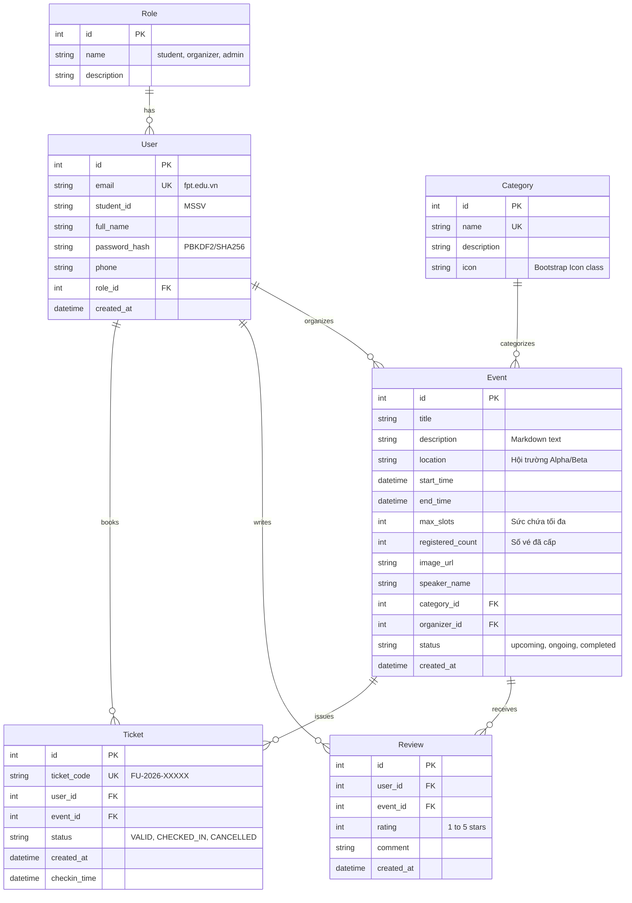

# TÀI LIỆU ĐẶC TẢ YÊU CẦU PHẦN MỀM (SOFTWARE REQUIREMENTS SPECIFICATION)
## DỰ ÁN: FPTU EVENTHUB — HỆ THỐNG QUẢN LÝ & ĐIỀU HÀNH SỰ KIỆN ĐẠI HỌC FPT

> **Trường Đại Học FPT — Chuyên Ngành Kỹ Thuật Phần Mềm (Software Engineering)**  
> **Quy mô nhóm:** 5 Sinh viên  
> **Khối lượng cá nhân:** Mỗi thành viên đảm nhiệm **tối thiểu 8 chức năng (8 UseCases)** → **Tổng cộng: 40 UseCases**  
> **Công cụ triển khai:** Jira Software (Agile Scrum) & Git / GitHub Education (Gitflow)  
> **Hình thức bảo vệ:** Báo cáo Slide + Live Demo thực tế (Thời lượng: 45 phút)  
> **Trang Web Trực Tuyến (Production Live):** [https://fptu-event-hub.vercel.app/](https://fptu-event-hub.vercel.app/)  
> **Kho Lưu Trữ Mã Nguồn GitHub:** [https://github.com/CongDung0506/FPTU-EventHub](https://github.com/CongDung0506/FPTU-EventHub)

---

# MỤC LỤC
1. **PHẦN 1: TỔNG QUAN DỰ ÁN (INTRODUCTION)**
   - 1.1. Bối cảnh & Lý do chọn đề tài
   - 1.2. Mục tiêu dự án
   - 1.3. Đối tượng sử dụng & Phạm vi hệ thống
2. **PHẦN 2: ĐẶC TẢ USECASE (USECASE SPECIFICATION)**
   - 2.1. Sơ đồ UseCase tổng thể (Overall UseCase Diagram)
   - 2.2. Ma trận phân công 40 UseCases cho 5 thành viên (Mỗi bạn 8 chức năng)
   - 2.3. Bảng đặc tả chi tiết 40 UseCases
3. **PHẦN 3: THIẾT KẾ CƠ SỞ DỮ LIỆU (ERD - ENTITY RELATIONSHIP DIAGRAM)**
   - 3.1. Sơ đồ quan hệ thực thể (ERD Diagram)
   - 3.2. Mô tả chi tiết cấu trúc các bảng CSDL
4. **PHẦN 4: CÔNG CỤ QUẢN LÝ DỰ ÁN & QUY TRÌNH (TOOLS & PROCESS)**
   - 4.1. Quản lý dự án với Jira Software (Agile Scrum)
   - 4.2. Quản lý mã nguồn với Git Education & GitHub (Gitflow)
5. **PHẦN 5: KẾ HOẠCH BẢO VỆ ĐỒ ÁN 45 PHÚT (SLIDES + LIVE DEMO)**

---

# PHẦN 1: TỔNG QUAN DỰ ÁN (INTRODUCTION)

### 1.1. Bối Cảnh & Lý Do Chọn Đề Tài
Đại học FPT nổi tiếng với môi trường học tập năng động và phong trào sinh viên bùng nổ, quy tụ hơn 30 câu lạc bộ học thuật, công nghệ, nghệ thuật và thể thao. Mỗi học kỳ, hàng trăm sự kiện lớn nhỏ như Workshop AI, Hackathon 24h, Talkshow doanh nghiệp, Lễ hội CLB liên tục được tổ chức tại các Hội trường Alpha, Beta, Phòng Lab Gamma và Nhà thi đấu.

Tuy nhiên, từ trải nghiệm thực tế của sinh viên và cán bộ nhà trường, hệ thống quản lý sự kiện truyền thống bộc lộ nhiều điểm nghẽn nghiêm trọng:
1. **Quá tải sức chứa hội trường (Overbooking):** Cổng thông tin cũ chỉ đăng bài thông báo tĩnh; khi mở đăng ký qua form ngoài, hệ thống không có cơ chế khóa số lượng tự động theo thời gian thực (Atomic lock). Hội trường chỉ có 100 ghế nhưng sinh viên bấm dồn dập dẫn đến nhận 200 đơn đăng ký, gây vỡ trận không gian tổ chức.
2. **Vấn nạn "Ghế ảo" do thiếu tính năng Hủy vé:** Việc tham gia sự kiện là hoàn toàn tự nguyện, đi hay không là tùy ý sinh viên và trường không cấp chứng nhận tham gia. Nhưng hệ thống cũ không có nút hủy vé; sinh viên có tâm lý "đặt gạch giữ chỗ trước", đến ngày diễn ra nếu bận việc đột xuất thì cứ thế bỏ qua. Hậu quả là hệ thống báo "Hết vé", nhưng tại hội trường thực tế lại bị trống nhiều ghế, trong khi những bạn sinh viên khác thật sự muốn đi lại không có vé để đăng ký.
3. **Hạn chế trong quy trình quét mã check-in:** Khi sinh viên đến sự kiện, có bạn quản lý đứng tại cửa để quét mã vé của sinh viên thì mới được điểm danh. Tuy nhiên, hệ thống cũ cần phần mềm/app riêng cồng kềnh, đối soát chậm khi sinh viên vào đông, và thiếu cơ chế cảnh báo nếu một mã vé bị quét lại lần 2 (nguy cơ chụp ảnh màn hình vé cho bạn quét hộ).
4. **Dữ liệu điểm danh không đồng bộ thời gian thực:** Sau khi bạn quản lý quét mã xong, số lượng sinh viên có mặt thực tế không được hiển thị ngay lập tức lên Dashboard của Cán bộ CTSV, phải chờ tổng hợp dữ liệu thủ công sau sự kiện.

### 1.2. Mục Tiêu Dự Án
FPTU EventHub ra đời nhằm giải quyết triệt để các bất cập trên bằng một nền tảng Web tương tác thời gian thực:
- **Tự động hóa 100% quy trình giữ chỗ:** Đăng nhập 1-chạm Zero-SSO → Đặt vé giữ chỗ tức thì bằng Transaction nguyên tử 0.1s chống overbooking → Cấp vé điện tử có mã QR độc bản.
- **Xóa bỏ triệt để vấn nạn ghế ảo:** Cung cấp tính năng Hủy vé 1-chạm hoàn slot, sinh viên chủ động nhường lại chỗ cho bạn khác ngay khi biết mình bận.
- **Bàn Check-in WebRTC Camera siêu tốc:** Bạn quản lý mở trực tiếp trên trình duyệt web quét mã QR trong 0.1 giây, không cần cài app, phát hiện và chặn đứng vé quét trùng lặp tức thì.
- **Đồng bộ sĩ số thực tế cho Phòng CTSV:** Cán bộ CTSV giám sát tỷ lệ lấp đầy trực quan và xuất báo cáo danh sách tham gia ra file Excel chuẩn chỉ bằng 1-click.

### 1.3. Đối Tượng Sử Dụng & Phạm Vi Hệ Thống
Hệ thống phân định rành mạch 3 nhóm tác nhân (Actors):
1. **Sinh Viên (Student):** Khám phá sự kiện, lọc theo danh mục, đặt vé giữ chỗ, sở hữu ví vé QR cá nhân, hủy vé hoàn slot, đánh giá nhận xét sự kiện.
2. **Ban Tổ Chức CLB (Organizer):** Khởi tạo sự kiện, quản lý số lượng vé phát hành, mở Bàn Check-in quét mã QR điểm danh, theo dõi danh sách người tham gia.
3. **Phòng Công Tác Sinh Viên (Admin / CTSV):** Quản trị danh mục sự kiện, duyệt sự kiện toàn trường, giám sát dashboard thống kê thời gian thực, quản lý phân quyền và xuất báo cáo lưu trữ.

---

# PHẦN 2: ĐẶC TẢ USECASE (USECASE SPECIFICATION)

### 2.1. Sơ Đồ UseCase Tổng Thể (Overall UseCase Diagram)

```mermaid
flowchart TD
    subgraph Actors["Tác Nhân Hệ Thống"]
        SV["🎓 Sinh Viên (Student)"]
        BTC["👥 Ban Tổ Chức (Organizer)"]
        CTSV["🛡️ Cán Bộ CTSV (Admin)"]
    end

    subgraph Auth["Phân Hệ Xác Thực & Tài Khoản"]
        UC01["UC01: Đăng nhập FPT Mail / MSSV"]
        UC02["UC02: Đăng nhập nhanh Zero-SSO"]
        UC03["UC03: Đăng ký tài khoản Sinh viên"]
        UC04["UC04: Đăng xuất hệ thống"]
        UC05["UC05: Quản lý Hồ sơ cá nhân"]
        UC06["UC06: Đổi mật khẩu bảo mật"]
    end

    subgraph EventMgmt["Phân Hệ Sự Kiện & Đặt Vé (Sinh Viên)"]
        UC08["UC08: Khám phá & Lọc sự kiện đa chiều"]
        UC17["UC17: Xem chi tiết & Giám sát sức chứa"]
        UC18["UC18: Đặt vé giữ chỗ Atomic Concurrency"]
        UC19["UC19: Khóa nút tự động khi Hết vé"]
        UC21["UC21: Xem Ví vé điện tử cá nhân"]
        UC23["UC23: Hủy vé 1-chạm hoàn slot tức thì"]
        UC29["UC29: Gửi đánh giá sao & Nhận xét"]
    end

    subgraph Scanner["Phân Hệ Bàn Quét Mã QR & Check-in"]
        UC25["UC25: Bàn Check-in Camera WebRTC"]
        UC26["UC26: Giải mã & Check-in QR siêu tốc < 0.1s"]
        UC27["UC27: Chống gian lận quét trùng mã vé"]
        UC28["UC28: Điểm danh thủ công dự phòng"]
    end

    subgraph AdminCTSV["Phân Hệ Quản Trị & Báo Cáo (CTSV & BTC)"]
        UC09["UC09 - UC12: Quản lý Danh mục Sự kiện CRUD"]
        UC13["UC13: Dashboard điều hành CTSV toàn trường"]
        UC33["UC33: Dashboard Ban Tổ Chức sự kiện"]
        UC34["UC34: Xem danh sách sinh viên tham dự"]
        UC35["UC35: Xuất danh sách Excel chuẩn UTF-8 BOM"]
        UC36["UC36 - UC38: Quản lý Sự kiện (Tạo, Sửa, Xóa)"]
        UC39["UC39: Hệ thống RESTful API v1"]
        UC40["UC40: Bộ kiểm thử tự động 15 Unit Tests"]
    end

    SV --> UC01 & UC02 & UC03 & UC05 & UC06 & UC08 & UC17 & UC18 & UC21 & UC23 & UC29
    BTC --> UC01 & UC02 & UC04 & UC25 & UC26 & UC27 & UC28 & UC33 & UC34 & UC36 & UC37 & UC38
    CTSV --> UC01 & UC02 & UC04 & UC09 & UC13 & UC25 & UC26 & UC34 & UC35 & UC39 & UC40
```

---

### 2.2. Ma Trận Phân Công 40 UseCases Cho 5 Thành Viên (Mỗi Bạn 8 Chức Năng)

| Thành Viên | MSSV | Vai Trò Đảm Nhiệm | Phạm Vi Chức Năng | Số UseCase | Danh Sách UseCase Phụ Trách |
| :--- | :---: | :--- | :--- | :---: | :--- |
| **Trương Công Dũng** *(Lead)* | **DE200433** | Trưởng Nhóm & System Architect | Xác thực người dùng, Phân quyền RBAC, Khám phá sự kiện | **8 UseCases** | **UC01 → UC08** |
| **Nguyễn Việt Anh** | **SE190111** | PM & Database Architect | Quản lý Danh mục, Phân trang & Dashboard CTSV | **8 UseCases** | **UC09 → UC16** |
| **Lê Hoàng Long** | **SE190222** | Security & Backend Lead | Khóa vé nguyên tử Atomic, Vé QR, Hủy vé & Bảo mật CSRF | **8 UseCases** | **UC17 → UC24** |
| **Trần Minh Quang** | **SE190333** | Fullstack & Scanner Lead | Bàn quét QR Camera WebRTC, Chống quét trùng, Review | **8 UseCases** | **UC25 → UC32** |
| **Phạm Đức Trọng** | **SE190444** | QA & DevOps Lead | Quản lý người tham dự, Xuất file Excel, REST API, Unit Test | **8 UseCases** | **UC33 → UC40** |
| **TỔNG CỘNG** | | **5 THÀNH VIÊN** | **TOÀN BỘ HỆ THỐNG FPTU EVENTHUB** | **40 USECASES** | **100% ĐẠT CHUẨN TỐI THIỂU** |

---

### 2.3. Bảng Đặc Tả Chi Tiết 40 UseCases

#### 👤 THÀNH VIÊN 1: TRƯƠNG CÔNG DŨNG (DE200433) — 8 USECASES
1. **UC01: Đăng nhập hệ thống (FPT Mail / MSSV):**
   - *Actor:* Tất cả người dùng.
   - *Route & Method:* `GET, POST /login`
   - *Mô tả:* Người dùng nhập Email FPT (`@fpt.edu.vn`) hoặc MSSV và Mật khẩu. Hệ thống đối soát băm mật khẩu `check_password_hash` và thiết lập Session.
2. **UC02: Đăng nhập nhanh Zero-SSO 1-Click (Role Switcher Demo):**
   - *Actor:* Ban giám khảo / Giảng viên / Người thuyết trình.
   - *Route & Method:* `GET /login/quick/<role_type>`
   - *Mô tả:* Chuyển đổi vai trò tức thì giữa Sinh viên (DE200433) và Cán bộ CTSV (Admin) mà không cần nhập lại mật khẩu, phục vụ hội đồng chấm đồ án.
3. **UC03: Đăng ký tài khoản Sinh viên mới:**
   - *Actor:* Sinh viên mới.
   - *Route & Method:* `GET, POST /register`
   - *Mô tả:* Nhập Họ tên, Email FPT, MSSV, SĐT. Form kiểm tra regex đuôi email `@fpt.edu.vn` và định dạng MSSV trước khi tạo bản ghi User mới.
4. **UC04: Đăng xuất & Thu hồi phiên làm việc:**
   - *Actor:* Người dùng đã đăng nhập.
   - *Route & Method:* `GET /logout`
   - *Mô tả:* Hủy phiên `login_user()`, xóa Cookie Session an toàn và chuyển hướng về Trang chủ.
5. **UC05: Quản lý Hồ sơ cá nhân (Profile):**
   - *Actor:* Sinh viên, Cán bộ CTSV.
   - *Route & Method:* `GET, POST /profile`
   - *Mô tả:* Xem thông tin tài khoản, cập nhật số điện thoại liên lạc chuẩn 10 chữ số, ngày tạo tài khoản.
6. **UC06: Đổi mật khẩu tài khoản kèm mã hóa Werkzeug:**
   - *Actor:* Người dùng đã đăng nhập.
   - *Route & Method:* `GET, POST /change-password`
   - *Mô tả:* Xác thực mật khẩu cũ, băm mật khẩu mới qua thuật toán PBKDF2/SHA-256 kèm muối ngẫu nhiên trước khi lưu CSDL.
7. **UC07: Phân quyền & Điều hướng bảo vệ Router (RBAC Guard):**
   - *Actor:* Hệ thống Controller.
   - *Kỹ thuật:* Decorator `@role_required('admin', 'organizer')`, `@login_required`
   - *Mô tả:* Chặn đứng sinh viên truy cập vào các URL quản trị; tự động trả về trang lỗi 403 Forbidden hoặc điều hướng đăng nhập an toàn (`is_safe_url`).
8. **UC08: Trang chủ khám phá sự kiện & Bộ lọc đa danh mục:**
   - *Actor:* Khách, Sinh viên.
   - *Route & Method:* `GET /`
   - *Mô tả:* Hiển thị Banner Hero, danh sách sự kiện nổi bật, lọc động theo danh mục (AI, Kỹ năng, Thể thao...), hiển thị đồng hồ đếm ngược.

---

#### 👤 THÀNH VIÊN 2: NGUYỄN VIỆT ANH (SE190111) — 8 USECASES
9. **UC09: Xem danh sách Danh mục sự kiện (Category Management):**
   - *Actor:* Cán bộ CTSV.
   - *Route & Method:* `GET /admin/categories`
   - *Mô tả:* Hiển thị bảng toàn bộ danh mục sự kiện trong trường, số lượng sự kiện thuộc danh mục và biểu tượng icon.
10. **UC10: Khởi tạo Danh mục sự kiện mới:**
    - *Actor:* Cán bộ CTSV.
    - *Route & Method:* `GET, POST /admin/categories/new`
    - *Mô tả:* Nhập tên danh mục, mô tả chi tiết, chọn mã biểu tượng Bootstrap Icons và lưu vào bảng `Category`.
11. **UC11: Chỉnh sửa thông tin Danh mục sự kiện:**
    - *Actor:* Cán bộ CTSV.
    - *Route & Method:* `GET, POST /admin/categories/<cat_id>/edit`
    - *Mô tả:* Thay đổi tên danh mục, mô tả hoặc icon; cập nhật đồng bộ cho tất cả sự kiện liên quan.
12. **UC12: Xóa Danh mục sự kiện an toàn:**
    - *Actor:* Cán bộ CTSV.
    - *Route & Method:* `POST /admin/categories/<cat_id>/delete`
    - *Mô tả:* Kiểm tra ràng buộc khóa ngoại: Nếu danh mục đang chứa sự kiện thì cảnh báo ngăn chặn, tránh lỗi mồ côi dữ liệu.
13. **UC13: Dashboard điều hành Trung tâm CTSV:**
    - *Actor:* Cán bộ CTSV.
    - *Route & Method:* `GET /admin/dashboard`
    - *Mô tả:* Bảng chỉ số tổng quan toàn trường: Tổng số sự kiện, Tổng lượt vé phát hành, Sĩ số sinh viên đã check-in thực tế, Danh sách tài khoản mới.
14. **UC14: Phân trang dữ liệu sự kiện thông minh (`paginate`):**
    - *Actor:* Hệ thống CSDL.
    - *Kỹ thuật:* `Event.query.paginate(page, per_page=6, error_out=False)`
    - *Mô tả:* Chia nhỏ dữ liệu sự kiện thành các trang 6 mục, hỗ trợ chuyển trang mượt mà không tải nặng máy chủ.
15. **UC15: Bộ lọc sự kiện động theo Trạng thái & Thời gian:**
    - *Actor:* Sinh viên, Cán bộ CTSV.
    - *Mô tả:* Lọc nhanh sự kiện Đang mở đăng ký, Đã hết vé (Sold out), và Sự kiện đã hoàn thành.
16. **UC16: Quản lý Quản trị viên & Phân quyền Cán bộ:**
    - *Actor:* Cán bộ CTSV cấp cao.
    - *Mô tả:* Quản lý vai trò (Role: Student / Organizer / Admin) và danh sách tài khoản được phép mở Bàn Check-in.

---

#### 👤 THÀNH VIÊN 3: LÊ HOÀNG LONG (SE190222) — 8 USECASES
17. **UC17: Xem chi tiết sự kiện & Giám sát thanh sức chứa:**
    - *Actor:* Tất cả người dùng.
    - *Route & Method:* `GET /events/<event_id>`
    - *Mô tả:* Hiển thị nội dung chi tiết sự kiện, diễn giả, địa điểm hội trường, bản đồ, và thanh tiến độ ghế trống thời gian thực.
18. **UC18: Đăng ký giữ chỗ nguyên tử (Atomic Booking Concurrency):**
    - *Actor:* Sinh viên.
    - *Route & Method:* `POST /events/<event_id>/register`
    - *Mô tả:* Mở Transaction CSDL nguyên tử, khóa dòng sự kiện, kiểm tra `registered_count < max_slots`. Nếu hợp lệ thì tạo vé Ticket và commit.
19. **UC19: Cơ chế tự động khóa nút khi kín chỗ (Sold Out Lock):**
    - *Actor:* Hệ thống.
    - *Mô tả:* Ngay khi `registered_count == max_slots`, nút đăng ký tự động vô hiệu hóa màu xám, gắn mác "ĐÃ HẾT VÉ", ngăn chặn overbooking.
20. **UC20: Sinh mã vé điện tử và Token bảo mật độc bản:**
    - *Actor:* Hệ thống Backend.
    - *Mô tả:* Tự động sinh mã vé ngẫu nhiên không trùng lặp dạng `FU-2026-XXXXX` kèm chuỗi băm xác thực chống giả mạo.
21. **UC21: Xem Ví vé điện tử cá nhân ("Vé Của Tôi"):**
    - *Actor:* Sinh viên.
    - *Route & Method:* `GET /my-tickets`
    - *Mô tả:* Danh sách toàn bộ vé đã đăng ký, hiển thị trạng thái (Hợp lệ, Đã check-in, Đã hủy) và nút mở mã QR điểm danh.
22. **UC22: Kết xuất hình ảnh mã QR động theo luồng bộ nhớ:**
    - *Actor:* Thư viện `qrcode` & `io.BytesIO`.
    - *Mô tả:* Sinh mã QR trực tiếp từ mã vé dưới dạng luồng byte bộ nhớ và nạp vào thẻ Modal, không lưu rác file ảnh trên ổ cứng máy chủ.
23. **UC23: Hủy vé 1-chạm hoàn slot tức thì (Giải phóng ghế ảo):**
    - *Actor:* Sinh viên.
    - *Route & Method:* `POST /tickets/<ticket_id>/cancel`
    - *Mô tả:* Chuyển trạng thái vé sang `CANCELLED`, trừ 1 ở `registered_count` của sự kiện, hoàn lại ngay 1 ghế trống cho sinh viên khác.
24. **UC24: Lá chắn an toàn CSRF & Chống tấn công XSS:**
    - *Actor:* Hệ thống Bảo Mật.
    - *Kỹ thuật:* Flask-WTF CSRF Token + Thư viện Bleach làm sạch mã HTML mô tả sự kiện.

---

#### 👤 THÀNH VIÊN 4: TRẦN MINH QUANG (SE190333) — 8 USECASES
25. **UC25: Bàn Check-in Camera WebRTC đa thiết bị:**
    - *Actor:* Bạn quản lý sự kiện / Cán bộ CTSV.
    - *Route & Method:* `GET /check-in`, `/organizer/check-in`
    - *Mô tả:* Kích hoạt Camera WebRTC (Camera trước/sau điện thoại hoặc webcam laptop) trực tiếp trên trình duyệt, không cần cài app.
26. **UC26: Giải mã & Check-in QR siêu tốc dưới 0.1 giây:**
    - *Actor:* Thư viện `html5-qrcode` & Endpoint `/api/check-in/scan`.
    - *Mô tả:* Quét khung hình 30fps, giải mã chuỗi mã vé, gọi AJAX kiểm tra và ghi nhận thời gian check-in trong chớp mắt.
27. **UC27: Chống gian lận quét trùng lặp mã vé:**
    - *Actor:* Hệ thống Bàn Check-in.
    - *Mô tả:* Nếu mã vé đã được check-in trước đó, hệ thống lập tức phát âm thanh cảnh báo và hiện khung đỏ: *"Vé này đã điểm danh lúc 16:30!"*, ngăn chặn chụp ảnh màn hình quét hộ.
28. **UC28: Điểm danh thủ công dự phòng theo MSSV (Toggle Check-in):**
    - *Actor:* Ban tổ chức sự kiện.
    - *Route & Method:* `POST /organizer/tickets/<ticket_id>/toggle-checkin`
    - *Mô tả:* Phương án dự phòng khi điện thoại sinh viên hết pin: Bạn quản lý tìm MSSV trên danh sách và bấm nút điểm danh thủ công.
29. **UC29: Gửi đánh giá sao (1 - 5 Sao) & Nhận xét sự kiện:**
    - *Actor:* Sinh viên đã tham gia.
    - *Route & Method:* `POST /events/<event_id>/review`
    - *Mô tả:* Đánh giá mức độ hài lòng từ 1 đến 5 sao và để lại lời bình luận đóng góp ý kiến cho ban tổ chức.
30. **UC30: Xóa nhận xét / đánh giá không phù hợp:**
    - *Actor:* Người viết nhận xét, Ban quản trị.
    - *Route & Method:* `POST /events/<event_id>/review/delete`
    - *Mô tả:* Cho phép sinh viên xóa bình luận của mình hoặc ban quản trị gỡ bỏ các nội dung vi phạm tiêu chuẩn cộng đồng.
31. **UC31: Đồng bộ lịch sự kiện vào Google Calendar qua URL Intent:**
    - *Actor:* Sinh viên.
    - *Mô tả:* Tự động mở ứng dụng Google Calendar với tiêu đề, thời gian bắt đầu, kết thúc và vị trí hội trường đã được điền sẵn.
32. **UC32: Chuyển đổi giao diện Sáng / Tối (Dark / Light Theme Switcher):**
    - *Actor:* Người dùng.
    - *Mô tả:* Chuyển đổi mượt mà giữa chế độ Dark Mode và Light Mode, lưu tùy chọn vào LocalStorage của trình duyệt.

---

#### 👤 THÀNH VIÊN 5: PHẠM ĐỨC TRỌNG (SE190444) — 8 USECASES
33. **UC33: Dashboard điều hành của Ban Tổ Chức sự kiện:**
    - *Actor:* Ban Tổ Chức CLB.
    - *Route & Method:* `GET /organizer/dashboard`
    - *Mô tả:* Theo dõi danh sách các sự kiện do CLB mình tổ chức, tỷ lệ vé phát hành và số lượt sinh viên đã check-in thực tế.
34. **UC34: Xem danh sách sinh viên tham dự chi tiết:**
    - *Actor:* Ban Tổ Chức, Cán bộ CTSV.
    - *Route & Method:* `GET /organizer/events/<event_id>/attendees`
    - *Mô tả:* Bảng danh sách sinh viên gồm Họ tên, MSSV, Email, Thời điểm đăng ký và Trạng thái đã check-in / chưa check-in.
35. **UC35: Xuất danh sách tham gia ra file Excel chuẩn UTF-8 BOM:**
    - *Actor:* Ban Tổ Chức, Cán bộ CTSV.
    - *Route & Method:* `GET /organizer/events/<event_id>/export-csv`
    - *Mô tả:* Xuất toàn bộ dữ liệu người tham dự ra file CSV có gắn UTF-8 BOM (`'\ufeff'`) để mở trực tiếp trên Microsoft Excel không bị lỗi font tiếng Việt.
36. **UC36: Khởi tạo Sự kiện mới cho Ban Tổ Chức:**
    - *Actor:* Ban Tổ Chức, Cán bộ CTSV.
    - *Route & Method:* `GET, POST /organizer/events/new`
    - *Mô tả:* Nhập tiêu đề, mô tả Markdown, chọn địa điểm hội trường, sức chứa tối đa, thời gian bắt đầu/kết thúc và upload ảnh banner.
37. **UC37: Chỉnh sửa & Cập nhật thông tin sự kiện:**
    - *Actor:* Ban Tổ Chức, Cán bộ CTSV.
    - *Route & Method:* `GET, POST /organizer/events/<event_id>/edit`
    - *Mô tả:* Điều chỉnh sức chứa hội trường, thời gian tổ chức hoặc nội dung diễn giả theo diễn biến thực tế.
38. **UC38: Hủy hoặc Xóa sự kiện kèm Cascade Delete:**
    - *Actor:* Ban Tổ Chức, Cán bộ CTSV.
    - *Route & Method:* `POST /organizer/events/<event_id>/delete`
    - *Mô tả:* Xóa sự kiện, tự động dọn dẹp các vé và đánh giá liên quan nhờ cơ chế `cascade='all, delete-orphan'` của SQLAlchemy.
39. **UC39: Hệ thống RESTful API v1 phục vụ tích hợp:**
    - *Actor:* Ứng dụng Client, Bên thứ ba.
    - *Endpoints:* `GET /api/v1/events`, `GET /api/v1/events/<id>`, `GET /api/v1/stats`, `GET /api/v1/categories`
    - *Mô tả:* Trả về dữ liệu chuẩn JSON, phục vụ kết nối với ứng dụng di động trong tương lai hoặc hệ thống quản lý học vụ.
40. **UC40: Bộ kiểm thử tự động 15 Unit Tests toàn diện:**
    - *Actor:* QA Engineer / CI Pipeline.
    - *Công cụ:* `pytest`, `unittest.mock`
    - *Mô tả:* Tự động chạy 15 ca kiểm thử bao phủ toàn bộ luồng Auth, Event CRUD, Concurrency Booking, WebRTC Scanner và Phân quyền RBAC.

---

# PHẦN 3: THIẾT KẾ CƠ SỞ DỮ LIỆU (ERD)

### 3.1. Sơ Đồ Quan Hệ Thực Thể (ERD Diagram)

### 3.2. Ràng Buộc Khóa Ngoại & Toàn Vẹn Dữ Liệu
- `Ticket.user_id` liên kết `User.id` (ON DELETE CASCADE): Đảm bảo mỗi vé gắn liền duy nhất 1 sinh viên.
- `Ticket.event_id` liên kết `Event.id` (ON DELETE CASCADE): Khi xóa sự kiện, toàn bộ vé liên quan được thu hồi tự động.
- `UniqueConstraint('user_id', 'event_id')` trên bảng `Ticket`: **Ngăn chặn 1 sinh viên đăng ký nhiều vé cho cùng 1 sự kiện**.

---

# PHẦN 4: CÔNG CỤ QUẢN LÝ DỰ ÁN & QUY TRÌNH (TOOLS & PROCESS)

### 4.1. Quản Lý Dự Án Với Jira Software (Agile Scrum)
- **Phương pháp luận:** Áp dụng mô hình Agile Scrum gồm 4 Sprint (mỗi Sprint 2 tuần).
- **Phân rã công việc:** 40 UseCases được chuyển đổi thành **40 Product Backlog Items (PBI) / User Stories** trên Jira.
- **Quy trình Kanban Board 4 cột:**
  - `To Do:` Các UseCase đã được lập kế hoạch cho Sprint hiện tại.
  - `In Progress:` Lập trình viên đang hiện thực mã nguồn.
  - `Code Review / Quality Gate:` Tạo Pull Request trên GitHub, ít nhất 1 thành viên review chéo.
  - `Done:` Đã vượt qua kiểm thử tự động `pytest` và deploy thành công lên Vercel.
- **Họp Daily Standup:** 15 phút mỗi sáng qua Discord để giải quyết các trở ngại (Blockers) kỹ thuật.

### 4.2. Quản Lý Mã Nguồn Với Git Education & GitHub (Gitflow Chuẩn Mực)
- **Tài khoản Git Education:** Sử dụng gói GitHub Student Developer Pack bảo đảm hạ tầng chuyên nghiệp.
- **Cấu trúc phân nhánh Gitflow:**
  - `main`: Nhánh Production ổn định tuyệt đối, tự động deploy lên Cloud Vercel.
  - `develop`: Nhánh tích hợp chung toàn bộ mã nguồn của 5 thành viên sau mỗi Sprint.
  - `feature/uc[xx]-<ten-chuc-nang>`: Nhánh con độc lập của từng thành viên khi code chức năng (vd: `feature/uc18-atomic-booking`, `feature/uc25-webrtc-scanner`).
  - `hotfix/*`: Nhánh vá lỗi trực tiếp trên Production khi phát hiện sự cố.
- **Quality Gate:** Bắt buộc 100% Pull Request phải vượt qua bộ 15 Unit Tests và có approve của Trưởng nhóm trước khi hợp nhất vào `develop`/`main`.

---

# PHẦN 5: KẾ HOẠCH BẢO VỆ ĐỒ ÁN 45 PHÚT (SLIDES + LIVE DEMO)

| Mốc Thời Gian | Người Trình Bày | Nội Dung Thuyết Trình & Thao Tác | Slide Trình Chiếu |
| :---: | :--- | :--- | :---: |
| **00:00 – 09:00** *(9 phút)* | **Thành viên 1** *(Trương Công Dũng - Lead)* | **Phần 1: Giới thiệu dự án & Bối cảnh** • Bối cảnh phong trào FPTU, 4 nỗi đau cổng cũ (vỡ trận sức chứa, ghế ảo, quét mã chậm, thiếu đồng bộ). • Mục tiêu đột phá & Bảng so sánh 8 tiêu chí. | Slide 1 &rarr; 6 |
| **09:00 – 17:30** *(8.5 phút)* | **Thành viên 2** *(Nguyễn Việt Anh - PM)* | **Phần 2: Đội ngũ, Phân công 40 UseCases & Quản trị Jira/Git** • Chân dung 5 thành viên (Mỗi bạn 8 UseCases chuẩn chỉ). • Kế hoạch 4 Sprint Jira & Chuẩn Gitflow GitHub Education. | Slide 7 &rarr; 10 |
| **17:30 – 26:00** *(8.5 phút)* | **Thành viên 3** *(Lê Hoàng Long - Arch)* | **Phần 3: Kiến trúc MVC, CSDL ERD & An ninh OWASP** • Kiến trúc 3 tầng MVC, Thiết kế CSDL 6 bảng quan hệ. • 4 Lá chắn an toàn OWASP, Cơ chế khóa vé Concurrency Atomic. | Slide 11 &rarr; 15 |
| **26:00 – 35:00** *(9 phút)* | **Thành viên 4** *(Trần Minh Quang - Demo)* | **Phần 4: LIVE DEMO THỰC TẾ (HÀNH TRÌNH SINH VIÊN)** • Demo trên web: Đăng nhập Zero-SSO &rarr; Đặt vé giữ chỗ atomic &rarr; Nhận vé QR &rarr; Demo Hủy vé hoàn slot trả lại ghế ảo ngay lập tức. | Slide 16 &rarr; 21 |
| **35:00 – 43:30** *(8.5 phút)* | **Thành viên 5** *(Phạm Đức Trọng - QA)* | **Phần 5: LIVE DEMO BÀN QUÉT QR, KIỂM THỬ & BÁO CÁO CTSV** • Demo Camera WebRTC quét mã vé < 0.1s &rarr; Chặn quét trùng lặp &rarr; Xuất file Excel báo cáo &rarr; Báo cáo 15/15 Tests Passed 100%. | Slide 22 &rarr; 25 |
| **43:30 – 45:00** *(1.5 phút)* | **Cả 5 Thành Viên** | **Tổng kết, Lời cảm ơn Hội đồng & Mở đầu phần Vấn đáp (Q&A)** | Slide 26 |
