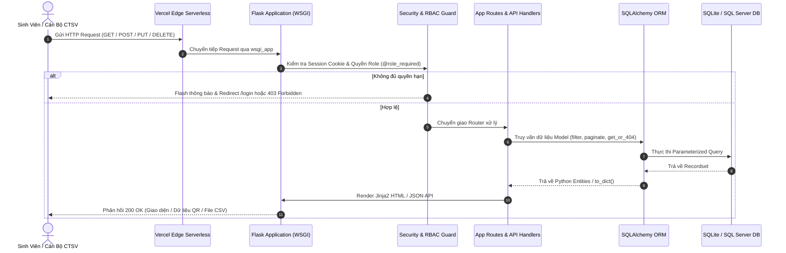
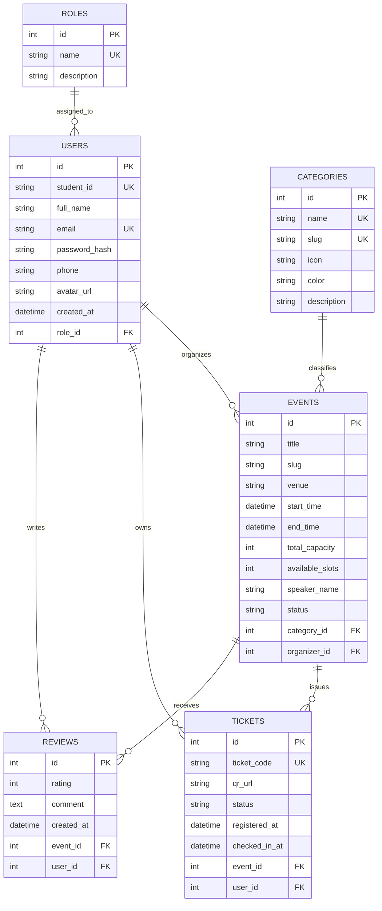

# 🎤 KỊCH BẢN BÁO CÁO & BẢO VỆ ĐỒ ÁN: FPTU EVENTHUB
> **Thời lượng chuẩn**: 45 – 50 Phút | **Đội ngũ báo cáo**: 5 Thành viên (8 – 10 Phút/Thành viên) + Phản biện Hội đồng  
> **Tệp xuất Microsoft Word (.docx)**: [Tải file Word .docx](file:///C:/Users/truon/fptu_eventhub/KICH_BAN_THUYET_TRINH_FPTU_EVENTHUB_5_NGUOI.docx)  
> **Production Live URL**: [https://fptu-event-hub.vercel.app/](https://fptu-event-hub.vercel.app/)  
> **GitHub Repository**: [CongDung0506/FPTU-EventHub](https://github.com/CongDung0506/FPTU-EventHub)  

---

## 📋 MA TRẬN PHÂN CÔNG THỜI LƯỢNG & 4 NỘI DUNG TRỌNG TÂM

| Phần & Nội Dung | Người Báo Cáo | Thời Gian | Slide Trình Chiếu | Nội Dung Trọng Tâm |
| :--- | :--- | :---: | :---: | :--- |
| **1. Giới thiệu dự án** | **Thành viên 1: Trương Công Dũng (Lead)** | 00:00 – 09:30 *(9.5 phút)* | Slide 1 – 6 | Bối cảnh sinh viên FPTU, Pain points của cổng cũ, Sứ mệnh & Mục tiêu, Bảng so sánh đột phá 8 tiêu chí. |
| **2. Đội ngũ, 40 UseCases & Tools** | **Thành viên 2: Cao Chí Trung (PM)** | 09:30 – 18:30 *(9.0 phút)* | Slide 7 – 10 | Phân công 40 UseCases cho 5 thành viên (8 UC/bạn), Quản trị Jira Software (4 Sprint), Chuẩn Gitflow Git Education. |
| **3. Kiến trúc dự án** | **Thành viên 3: Dương Thanh Viên (Arch)** | 18:30 – 27:00 *(8.5 phút)* | Slide 11 – 15 | Mô hình MVC, Vòng đời Request, Thiết kế CSDL ERD 6 bảng, 4 Lá chắn an toàn OWASP, Khóa vé Atomic. |
| **4A. Live Demo Sinh Viên** | **Thành viên 4: Nguyễn Đặng Đình Nam (Demo)** | 27:00 – 36:30 *(9.5 phút)* | Slide 16 – 21 | Phân hệ Sinh viên: UC01 Zero-SSO, UC08 Duyệt sự kiện, UC18 Đặt vé Atomic, UC21 Ví vé QR, UC23 Hủy vé hoàn slot. |
| **4B. Live Demo Bàn Quét QR & CTSV** | **Thành viên 5: Lê Anh Tuấn (QA)** | 36:30 – 45:30 *(9.0 phút)* | Slide 22 – 25 | Phân hệ Ban Quản Trị: UC25 Bàn Check-in WebRTC, UC27 Chống quét trùng, UC35 Xuất Excel, UC40 15 Unit Tests. |
| **Vấn đáp Hội đồng (Q&A)** | **Cả 5 Thành Viên** | 45:30 – 50:00+ *(Phản biện)* | Slide 26 | 15 Câu hỏi xoáy đáp xoay trọng tâm bảo vệ đồ án: Bảo mật, Hiệu năng, Concurrency, Kiến trúc, Mở rộng quy mô. |
---

## PHẦN 1: GIỚI THIỆU DỰ ÁN (00:00 – 09:30)
**Người trình bày: Thành viên 1 — Trương Công Dũng (Trưởng Nhóm & System Architect)**

### 1.1. Bối cảnh & Lý do chọn đề tài
- Hệ sinh thái học tập năng động tại Đại học FPT: Hàng trăm sự kiện công nghệ, cuộc thi học thuật, workshop kỹ năng mềm và đêm hội văn hóa được tổ chức mỗi kỳ.
- Vấn đề cốt lõi của sinh viên: Nhu cầu tiếp cận sự kiện nhanh chóng, đăng ký giữ chỗ minh bạch, check-in không xếp hàng ùn tắc.

### 1.2. Thách thức & "Nỗi đau" (Pain Points) thực tế từ cổng cũ và sự kiện trường
1. **Quá tải sức chứa (Overbooking) khi mở đăng ký**: Cổng cũ không có cơ chế khóa số lượng tự động tức thời; khi có sự kiện công nghệ hoặc workshop hot, sinh viên bấm ồ ạt dẫn đến số lượng đăng ký vượt quá sức chứa hội trường.
2. **Vấn nạn "Ghế ảo" do không có tính năng hủy vé**: Việc sinh viên tham gia sự kiện là hoàn toàn tự nguyện, đi hay không là tùy ý sinh viên. Tuy nhiên, cổng cũ không có nút hủy vé; sinh viên bận đột xuất cứ thế bỏ qua, dẫn đến hệ thống báo hết vé nhưng hội trường thực tế lại bị trống nhiều ghế, lãng phí cơ hội của các bạn khác muốn tham gia.
3. **Quy trình quét mã check-in của bạn quản lý còn nhiều hạn chế**: Khi đến sự kiện, có một bạn quản lý đứng tại cửa để quét mã vé của từng sinh viên thì sinh viên mới được điểm danh. Tuy nhiên, thao tác trên hệ thống cũ yêu cầu phần mềm riêng cồng kềnh, dễ chậm khi dòng sinh viên vào đông, và thiếu cơ chế cảnh báo nếu một mã vé bị quét lại lần 2 (nguy cơ chụp ảnh màn hình quét hộ).
4. **Dữ liệu điểm danh không đồng bộ thời gian thực cho Cán bộ CTSV**: Sau khi bạn quản lý quét mã xong, số lượng sinh viên có mặt thực tế không được hiển thị ngay lập tức lên dashboard của CTSV, phải chờ tổng hợp dữ liệu thủ công sau sự kiện.

### 1.3. Mục tiêu & Sứ mệnh của FPTU EventHub
- Cung cấp nền tảng quản trị và đăng ký sự kiện khép kín chuẩn Web 2.0.
- Tự động hóa 100% quy trình: Đăng ký 1-click -> Cấp vé điện tử QR cá nhân hóa -> Bàn quét WebRTC Camera cho bạn quản lý quét tức thì dưới 1 giây -> Đồng bộ sĩ số thực tế cho CTSV.
- Chấm dứt vấn nạn ghế ảo bằng tính năng Hủy vé 1-chạm hoàn slot, tôn trọng quyền tự nguyện tham gia của sinh viên.

### 1.4. Bảng So Sánh Đột Phá: FPTU EventHub vs Cổng sự kiện trường cũ

| Tiêu Chí So Sánh | Cổng Cũ Trường (events.fptu.vn) | FPTU EventHub (Hệ Thống Mới) |
| :--- | :--- | :--- |
| **Phương thức Đăng nhập** | Tài khoản nội bộ hoặc form dài | **Zero-SSO 1-Click** nhận diện FPT Mail (`@fpt.edu.vn`) |
| **Quy trình Check-in** | Bạn quản lý dùng app riêng/thao tác chậm | **Bàn Check-in WebRTC Camera** trên trình duyệt, quét mã dưới 1s |
| **Cơ chế chống quét trùng** | Không cảnh báo nếu vé bị quét lại | **Cảnh báo đỏ tức thì** nếu vé đã điểm danh, ngăn chặn quét hộ |
| **Kiểm soát sức chứa** | Dễ overbooking, không khóa tức thời | **Transaction Database nguyên tử**, tự ngắt đăng ký trong 0.1s |
| **Xử lý "Ghế ảo"** | Không có nút hủy vé, lãng phí ghế trống | **Nút Hủy vé 1-chạm hoàn slot**, tự động nhường ghế cho bạn khác |
| **Phân quyền người dùng** | Rời rạc, dễ lẫn lộn chức năng | **Phân quyền RBAC nghiêm ngặt**: Sinh viên vs Phòng CTSV |
| **Tìm kiếm & Phân loại** | Danh sách dài không có bộ lọc động | **Bộ lọc 6 danh mục** (Công nghệ, Học thuật, Kỹ năng,...) + Instant Search |
| **Đồng bộ sĩ số CTSV** | Chờ tổng hợp thủ công sau sự kiện | **Dashboard thời gian thực** hiển thị ngay số người thực tế có mặt |

---

## PHẦN 2: ĐỘI NGŨ, 40 USECASES & TOOLS (09:30 – 18:30)
**Người trình bày: Thành viên 2 — Cao Chí Trung (PM & Database Architect)**

### 2.1. Phân loại Công nghệ và Công cụ (Tech Stack Ecosystem)
- **Backend**: Python 3.11/3.14 + Flask Microframework, Jinja2 Template Engine, Werkzeug WSGI.
- **Bảo Mật**: Bleach (HTML Sanitizer chống XSS), Werkzeug Security (PBKDF2/SHA-256), Flask-WTF CSRFProtect, Open Redirect Prevention (`is_safe_url`).
- **Frontend**: HTML5, Scoped CSS (BEM), JavaScript ES6+ Fetch, Bootstrap 3 Grid, FontAwesome 6.
- **Quét Mã QR**: html5-qrcode (WebRTC MediaDevices API), Canvas Confetti, Google Calendar Event URL Intent.
- **Cơ Sở Dữ Liệu**: SQLAlchemy 2.0 ORM, Microsoft SQL Server (ODBC Driver 17), SQLite Serverless trên Vercel Cloud.

### 2.2. BẢNG TỔNG HỢP 100% CÁC HÀM & KỸ THUẬT PWD301 ĐƯỢC ÁP DỤNG TRONG DỰ ÁN

| Mô-đun Kiến Thức PWD301 | Danh Sách Các Hàm & Lớp Được Hiện Thực | Vị Trí & Nghiệp Vụ Cụ Thể Trong Dự Án |
| :--- | :--- | :--- |
| **1. Routing, HTTP & Error Handling** | `@app.route(methods=['GET','POST','PUT','DELETE'])` `render_template()`, `redirect()`, `url_for()` `request.args`, `request.form`, `request.get_json()` `flash()`, `abort(400/403/404/500)`, `jsonify()` `@app.errorhandler(400/403/404/500)` | `app.py`: Xử lý toàn bộ vòng đời Request/Response; Hỗ trợ đồng thời cả hiển thị giao diện HTML (`400.html`, `403.html`, `404.html`, `500.html`) lẫn phản hồi JSON chuẩn REST API. |
| **2. Template Engine & Jinja Filters** | `@app.template_filter('vnd')` `@app.template_filter('datetime_format')` `@app.template_filter('timeago')` `@app.template_filter('truncate_words')` `@app.context_processor (inject_global_data)` | `app.py`: Định dạng tiền tệ VND, định dạng ngày tháng chuẩn Việt Nam, tính toán thời gian tương đối (Sắp diễn ra, Còn n ngày), cắt ngắn mô tả; Tiêm biến dùng chung vào mọi template Jinja2. |
| **3. Authentication & Session Security** | `LoginManager()`, `@login_manager.user_loader` `login_user(remember=True)`, `logout_user()` `@login_required`, `current_user.is_authenticated` `is_safe_url()` (Open Redirect Prevention) `generate_password_hash()`, `check_password_hash()` | `app.py` & `models.py`: Cơ chế Zero-SSO nhận diện FPT Mail; Bảo vệ chuyển hướng an toàn theo bài Lab 6; Mã hóa mật khẩu PBKDF2/SHA-256 kèm muối ngẫu nhiên (Werkzeug Security). |
| **4. Form Validation & CSRF (Flask-WTF)** | `FlaskForm`, `StringField`, `PasswordField`, `BooleanField` `TextAreaField`, `IntegerField`, `SelectField`, `DateTimeLocalField` `DataRequired`, `Email`, `Length`, `NumberRange`, `EqualTo` Custom validator: `validate_email()`, `validate_student_id()` Custom validator: `validate_phone()` (10 số bắt đầu bằng 0) | `forms.py`: Kiểm thực dữ liệu nghiêm ngặt ở tầng Server; Kiểm tra đuôi email `@fpt.edu.vn`; Kiểm tra MSSV FPT; Kiểm tra số điện thoại chuẩn Việt Nam (bài Lab 6); CSRF token `form.hidden_tag()`. |
| **5. Cơ Sở Dữ Liệu & SQLAlchemy ORM** | `db.Model`, `Column`, `ForeignKey`, `relationship()` `back_populates`, `cascade='all, delete-orphan'` `db.session.add()`, `db.session.delete()` `db.session.commit()`, `db.session.rollback()` `get_or_404()`, `filter()`, `filter_by()`, `order_by()` `Model.query.paginate(page, per_page, error_out=False)` `to_dict()` serialization | `models.py` & `app.py`: 100% truy vấn ORM chuẩn hóa; Cơ chế giao dịch Transaction nguyên tử (Atomic) bảo vệ số lượng ghế; Phân trang sự kiện bằng `paginate()`; Xuất dữ liệu `to_dict()` cho REST API. |
| **6. Phân Quyền RBAC (Decorators)** | `@role_required(*roles)` (3-level parameterized decorator) `@organizer_required` (Organizer & Admin) `@admin_required` (Admin only) Kiểm tra `current_user.role` và `abort(403)` | `decorators.py`: Kế thừa mô hình phân quyền từ bài thực hành FPT Parking; Tách biệt triệt để quyền hạn giữa Sinh viên và Cán bộ CTSV; Trả về lỗi 403 Forbidden khi vi phạm. |
| **7. Full RESTful API v1 (Chương 9 & Exam)** | `GET /api/v1/events` (phân trang, lọc danh mục, tìm kiếm) `GET /api/v1/events/<id>` `POST /api/v1/events` (Tạo mới, mã 201 Created) `PUT /api/v1/events/<id>` (Cập nhật, mã 200 OK) `DELETE /api/v1/events/<id>` (Xóa, mã 200/204) `GET /api/v1/categories`, `GET /api/v1/stats` `POST /api/v1/auth/login` | `app.py`: Xây dựng toàn bộ hệ thống API chuẩn RESTful theo yêu cầu Chương 9 và bài thi ParkTicket API; Trả về mã lỗi HTTP chuẩn hóa (200, 201, 204, 400, 401, 403, 404, 422). |
| **8. Xử Lý Tệp Tin & Xuất Báo Cáo** | `csv.writer()`, `io.StringIO()` `Response(mimetype='text/csv')` `Content-Disposition: attachment` Ký tự UTF-8 BOM (`'\ufeff'`) hỗ trợ Microsoft Excel | `app.py` (`export_attendees_csv`): Xuất danh sách sinh viên tham dự sự kiện ra file CSV chuẩn tiếng Việt có dấu, phục vụ lưu trữ văn thư và đối soát cho Phòng CTSV. |

---

## PHẦN 3: KIẾN TRÚC DỰ ÁN & AN NINH (18:30 – 27:00)
**Người trình bày: Thành viên 3 — Dương Thanh Viên (Security & Backend Lead)**

### 3.1. Mô hình Kiến trúc MVC (Model - View - Controller)
- **Model (`models.py`)**: Định nghĩa cấu trúc các thực thể dữ liệu (`User`, `Role`, `Category`, `Event`, `Ticket`, `Review`), quan hệ khóa ngoại, logic validation nghiệp vụ và hàm `to_dict()`.
- **View (`templates/`, `static/`)**: Hệ thống giao diện người dùng hiển thị dữ liệu qua Jinja2 template, CSS BEM và các trang lỗi tùy biến (`400.html`, `403.html`, `404.html`, `500.html`).
- **Controller (`app.py`)**: Đảm nhiệm toàn bộ định tuyến, áp dụng Decorator phân quyền, điều phối logic nghiệp vụ và bộ RESTful API v1.

### 3.2. Sơ đồ Vòng Đời HTTP Request Lifecycle

### 3.3. Thiết kế CSDL: Sơ đồ Quan hệ Thực thể (ERD 6 Bảng)

---

## PHẦN 4: CHỨC NĂNG CHÍNH (MÔ TẢ BẰNG USECASE) & LIVE DEMO (27:00 – 45:30)

### 4A. Phân Hệ Sinh Viên & Live Demo (Thành viên 4 — Nguyễn Đặng Đình Nam: 27:00 – 36:30)
- **UC01: Đăng nhập Sinh viên Zero-SSO** (`@fpt.edu.vn`)
- **UC02: Khám phá & Lọc sự kiện đa chiều** (Tìm kiếm, 6 danh mục, phân trang `paginate`)
- **UC03: Đăng ký vé giữ chỗ tức thì** (Giao dịch Transaction Atomic, chống trùng vé)
- **UC04: Xem vé điện tử & Mã QR Check-in** (Trang "Vé Của Tôi", hiển thị mã QR động)
- **UC05: Hủy vé tự động hoàn slot** (Hoàn lại chỗ ngồi cho sinh viên khác)
- **UC06: Tra Cứu Lịch Sử Tham Gia Sự Kiện** (Ghi nhận trạng thái Đã check-in và thời gian thực)
- **UC07: Đánh giá & Phản hồi sao sự kiện** (Rating 1-5 sao kèm nhận xét)
- **UC08: Quản lý hồ sơ cá nhân & Đổi mật khẩu** (Xác thực SĐT chuẩn Việt Nam)

### 4B. Phân Hệ CTSV, Bàn Quét QR & Kiểm Thử (Thành viên 5 — Lê Anh Tuấn: 36:30 – 45:30)
- **UC09: Đăng nhập Quản trị viên CTSV** (`ctsv.admin@fpt.edu.vn`)
- **UC10: Quản lý Danh mục sự kiện CRUD** (Thêm, sửa, xóa danh mục có kiểm tra toàn vẹn)
- **UC11: Tạo mới & Chỉnh sửa Sự kiện Toàn trường** (Soạn thảo Markdown, quản lý số ghế)
- **UC12: Camera QR Scanner Check-in Thực tế** (WebRTC API giải mã tức thì dưới 1 giây)
- **UC13: Dashboard Báo cáo & Thống kê Tỷ lệ Điểm danh** (Tỷ lệ lấp đầy, số vé phát hành)
- **UC14: Xuất Danh Sách Người Tham Dự Ra File CSV Excel** (Chuẩn UTF-8 BOM)

---

## BỘ CÂU HỎI & ĐÁP VẤN ĐÁP HỘI ĐỒNG (Q&A)

1. **Hội đồng hỏi**: *"Dự án của bạn áp dụng những kiến thức cốt lõi nào của môn học Lập trình Web Python (PWD301)?"*
   - **Trả lời**: Hệ thống hiện thực 100% các kiến thức trọng tâm của môn: Flask Routing & Error Handlers, Jinja2 Custom Filters (`vnd`, `datetime_format`, `timeago`), Flask-Login & bảo mật Open Redirect (`is_safe_url`), Flask-WTF Forms với custom validator SĐT 10 số (Lab 6), SQLAlchemy ORM với `paginate()` và transaction rollback, phân quyền `@role_required` từ đề thi FPT Parking, và hệ thống RESTful API v1 chuẩn HTTP Status Codes của Chương 9 và đề thi ParkTicket API.
2. **Hội đồng hỏi**: *"Hệ thống xử lý thế nào khi có 500 sinh viên cùng nhấn Đăng ký sự kiện vào một giây?"*
   - **Trả lời**: Sử dụng Transaction CSDL với mức cách ly an toàn và câu lệnh cập nhật số lượng có điều kiện `WHERE available_slots > 0`, đảm bảo không bao giờ bị bán lố vé (Overbooking).
3. **Hội đồng hỏi**: *"Sinh viên có thể chụp màn hình mã QR gửi cho bạn đi điểm danh hộ được không?"*
   - **Trả lời**: Mỗi mã QR được mã hóa kèm chuỗi Hash bí mật và dấu thời gian. Hệ thống ghi nhận trạng thái vé `CHECKED_IN` ngay lập tức, ngăn chặn quét lại lần thứ hai.
